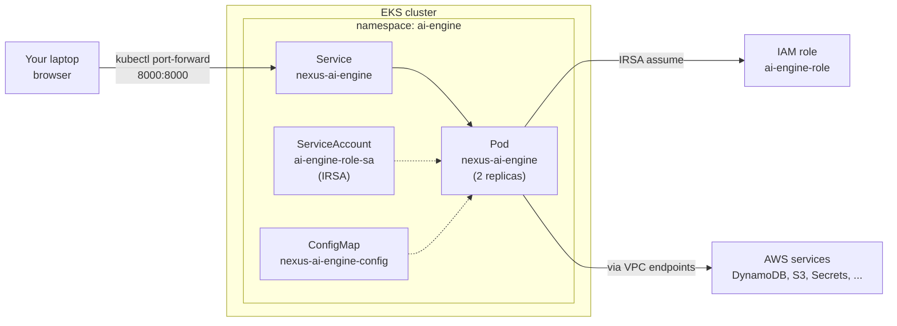

# nexus-ai-engine

Journey/stage/job AI orchestration engine extracted from `nexus-backend`.

Ships three things:

- A **library core** of port-based services for journeys, jobs, prompts, logs,
  reports, and SSE streaming. DynamoDB/S3 is the shipped default adapter;
  other adapters can be supplied by consumers.
- A **reference FastAPI + MCP server** (`nexus-ai-engine serve`) that composes
  the library into a standalone HTTP + MCP surface matching nexus-backend's
  existing API 1:1.
- An **importable testing harness** (`nexus_ai_engine.testing`) that lets any
  consumer exercise the engine in-process, including running plugin-journey
  YAMLs end-to-end, without a backend or AWS account.

## Status

**Pre-release (`0.1.0a1`).** The public API is not yet stable. Expect churn
during phases 2–9 of the extraction from
[`nexus-backend`](https://github.com/nexusdataai/nexus-backend) until `0.1.0`.

## Install

```bash
# From the internal Python index
pip install nexus-ai-engine

# Direct from GitHub (pin to a tag or main)
pip install "nexus-ai-engine @ git+https://github.com/nexusdataai/nexus-ai-engine.git@main"

# Editable, side-by-side with nexus-backend during development
pip install -e /path/to/nexus-ai-engine
```

Available extras:

```bash
pip install "nexus-ai-engine[aws]"      # boto3/botocore for the default adapters
pip install "nexus-ai-engine[server]"   # FastAPI + uvicorn + fastmcp + httpx
pip install "nexus-ai-engine[harness]"  # everything above + behave + pytest-benchmark
pip install "nexus-ai-engine[test,dev]" # full test + dev toolchain
```

## Package layout

```
src/nexus_ai_engine/
  config.py          # EngineConfig dataclass
  factory.py         # build_engine(config)
  errors.py          # EngineError + subclasses
  contracts/         # Protocol ports (repositories, sinks, events, scheduler, stage factory)
  models/            # Pydantic domain models (journey, prompt, logs/reports)
  stages/            # BaseStage, stage registry, PluginJourneyStage
  execution/         # TransformationJobExecutor, AsyncioJobScheduler
  services/          # JourneyService, PromptsService, LogsAndReportsService
  events/            # SSEManager / EventSink implementations
  adapters/          # DynamoDB, S3, in-memory shipped adapters
  server/            # Reference FastAPI app + routers + MCP + CLI
  testing/           # make_test_app, JourneyYAMLRunner, pytest fixtures plugin
```

## Quickstart — local reference server

```bash
make install-venv
source .venv/bin/activate
make serve                              # http://localhost:8001/health
```

Or via Docker:

```bash
make docker-build && make docker-run    # http://localhost:8000/health
```

Or docker-compose:

```bash
make compose-up
```

Health/readiness/version plus the journey/job/logs/reports/prompts/schedules
routes are all live against an in-memory engine, so the reference server is
exercisable end-to-end today. See [docs/ROUTE_PARITY.md](docs/ROUTE_PARITY.md)
for the canonical surface; handlers will swap their backing repository to
DynamoDB in phase 10 without changing the router contract.

## Embedded journey studio UI

The reference server ships a small React UI bundled inside the Python
package. Open it with `kubectl port-forward` — no ingress, no auth, no
build tooling:

```bash
# Local dev
make serve
open http://localhost:8001/ui

# Deployed pod
kubectl -n ai-engine port-forward svc/nexus-ai-engine 8000:8000
open http://localhost:8000/ui
```

What you can do:

- Browse the 5 seeded journeys (order-to-cash, call-processing,
  demand-forecasting, inventory-optimization, supply-chain-risk) with
  search, filters, and per-journey KPIs.
- Open a **Journey Studio** to view stages + steps and click
  **Start Processing** to kick off a simulated job; live progress streams
  via SSE into a logs drawer.
- Inspect job history, **Cancel** running jobs, **Retry** failed ones.
- Manage **Batch Schedules** — create, toggle, delete, Run Now.
- Edit the **prompts catalog** with a version-history audit log and a
  one-click reset to defaults.

See [docs/UI.md](docs/UI.md) for the architecture, component tree, and how
to add pages or API routes.

## Integration guidelines

`nexus-ai-engine` is designed to be embedded in three different shapes. Pick
the one that matches your host application; the underlying core is the same.

| Mode | Best for | Install | Coupling |
|------|----------|---------|----------|
| 1. Embed as a Python library | Apps that already host their own framework and want direct service calls | `nexus-ai-engine[aws]` | Tightest — single process |
| 2. Mount the FastAPI routers in your app | Apps using FastAPI that want the journey/job/prompts HTTP surface "for free" | `nexus-ai-engine[server,aws]` | Same process, separate URL prefix |
| 3. Run as an independent pod / microservice | Polyglot fleets, language-agnostic clients, multi-tenant isolation | Docker image / `[server]` extra | HTTP boundary |
| 4. Connect via MCP | LLM clients (Claude Desktop, Cursor, custom MCP hosts) | `[server]` extra (phase 7+) | stdio / HTTP MCP |
| 5. Use the harness in your own tests | Anyone — the harness is import-safe at any time | `nexus-ai-engine[harness]` | Test-time only |

Modes 1 + 5 are usable today. Mode 2 is usable today but the routers return
501 until phases 5–9 land. Mode 3 follows mode 2. Mode 4 activates in
phase 7.

### Mode 1 — Embed as a Python library

For apps that want to call services directly without HTTP overhead.

```python
# your_app/bootstrap.py
from nexus_ai_engine.config import EngineConfig
from nexus_ai_engine.factory import build_engine

config = EngineConfig(
    region="us-east-1",
    role_arn="arn:aws:iam::123456789012:role/your-engine-role",
    dynamodb_transformation_table="prod-transformation",
    dynamodb_prompts_table="prod-prompts",
    s3_journey_logs_bucket="prod-journey-logs",
    s3_journey_reports_bucket="prod-journey-reports",
    max_concurrent_jobs=20,
)

engine = build_engine(config)

# Once phases 5+ land, services become available:
#   journey_id = await engine.journeys.create(...)
#   job_id     = await engine.jobs.run(journey_id, stage_id, ...)
#   logs       = await engine.logs.get(journey_id, job_id, step_id)
```

Custom domain stages register at startup via the stage registry (activates
phase 8):

```python
from nexus_ai_engine.stages import register_stage
from your_app.stages import MyCustomStage

register_stage("my_custom_stage", MyCustomStage)
```

### Mode 2 — Mount the FastAPI routers in your app

For host apps that already run FastAPI (e.g. nexus-backend itself in
phase 10+). Use the library's routers under their canonical prefixes;
add your own auth, rate-limiting, and observability middleware on top.

```python
# your_app/main.py
from fastapi import FastAPI

from nexus_ai_engine.factory import build_engine
from nexus_ai_engine.config import EngineConfig
from nexus_ai_engine.server.app import (
    JOURNEYS_PREFIX,
    PROMPTS_PREFIX,
)
from nexus_ai_engine.server.routers import (
    health,
    journeys,
    jobs,
    logs,
    reports,
    prompts,
)

app = FastAPI(title="Your App")

# Your own auth middleware FIRST — the library does not ship auth
app.add_middleware(YourCognitoAuthMiddleware)

# Then mount the engine routers
app.include_router(health.router, tags=["health"])
app.include_router(journeys.router, prefix=JOURNEYS_PREFIX, tags=["journeys"])
app.include_router(jobs.router,     prefix=JOURNEYS_PREFIX, tags=["jobs"])
app.include_router(logs.router,     prefix=JOURNEYS_PREFIX, tags=["logs"])
app.include_router(reports.router,  prefix=JOURNEYS_PREFIX, tags=["reports"])
app.include_router(prompts.router,  prefix=PROMPTS_PREFIX,  tags=["prompts"])

@app.on_event("startup")
async def _wire_engine() -> None:
    app.state.engine = build_engine(EngineConfig(...))
```

The reference server's `create_app(engine)` does the same wiring for you if
you don't need to interleave with other routers — see
`nexus_ai_engine.server.create_app`.

### Mode 3 — Run as an independent pod / microservice

Already wired end-to-end. Build the image, deploy the manifests, talk to it
over HTTP. See the [Deployment as an independent pod](#deployment-as-an-independent-pod)
section below. Calls from another service:

```python
import httpx

NEXUS = "http://nexus-ai-engine.nexus-ai-engine-dev.svc.cluster.local:8000"

async def list_journeys() -> list[dict]:
    async with httpx.AsyncClient(base_url=NEXUS) as client:
        resp = await client.get("/api/v1/journeys/")
        resp.raise_for_status()
        return resp.json()
```

Health probes for Kubernetes / your load balancer:

| Endpoint     | Use as                |
|--------------|-----------------------|
| `/health`    | liveness probe        |
| `/readiness` | readiness probe       |
| `/version`   | deployment audit      |

### Mode 4 — Connect via MCP

When phase 7 lands, the same library backs an MCP server exposing the
`journey_tool` and `logs_and_reports_tool` tools (1:1 schema parity with
nexus-backend so existing MCP clients work unchanged):

```bash
# stdio (Claude Desktop, Cursor)
nexus-ai-engine serve --mcp-stdio

# HTTP MCP (other hosts)
nexus-ai-engine serve --mcp-http --port 9000
```

Configure your MCP client to invoke the binary or hit the HTTP endpoint
exactly as it would for nexus-backend's MCP server today.

### Mode 5 — Use the harness in your own tests

Any project depending on `nexus-ai-engine[harness]` automatically picks up
the shipped pytest fixtures (registered via the `pytest11` entry point):

```python
# your_project/tests/test_my_journey.py
import pytest

@pytest.mark.asyncio
async def test_my_journey_runs(http_client, journey_runner, samples_dir):
    # 1. Hit the in-process FastAPI harness
    health = await http_client.get("/health")
    assert health.status_code == 200

    # 2. Run a plugin-journey YAML end-to-end (phase 9+)
    result = journey_runner.run(samples_dir / "my_journey.yaml")
    assert result.ok
```

The harness factories are also usable directly (no pytest required):

```python
from nexus_ai_engine.testing import (
    JourneyYAMLRunner,
    TestHttpClient,
    make_test_app,
    make_test_engine,
)

app = make_test_app()
async with TestHttpClient(app) as client:
    resp = await client.get("/api/v1/journeys/")
```

`TestHttpClient(base_url="https://nexus-ai-engine-dev....")` works the same
way against a real deployed pod, so the same test code runs in-process for
CI and against staging for smoke checks.

### Configuration contract

All configuration flows through `EngineConfig` ([src/nexus_ai_engine/config.py](src/nexus_ai_engine/config.py)).
The library never reads environment variables itself; consumers build the
dataclass from whichever source they prefer (env, SSM, Secrets Manager,
Kubernetes ConfigMap, app config file).

The reference server's CLI does read env vars as a convenience; the
authoritative names are:

| Env var | EngineConfig field | Required by phase |
|---------|--------------------|-------------------|
| `AWS_REGION`                       | `region`                          | 5+ |
| `AWS_ROLE_ARN`                     | `role_arn`                        | optional |
| `DYNAMODB_TRANSFORMATION_TABLE`    | `dynamodb_transformation_table`   | 7 |
| `DYNAMODB_PROMPTS_TABLE`           | `dynamodb_prompts_table`          | 5 |
| `S3_JOURNEY_LOGS_BUCKET`           | `s3_journey_logs_bucket`          | 6 |
| `S3_JOURNEY_REPORTS_BUCKET`        | `s3_journey_reports_bucket`       | 6 |
| `MAX_CONCURRENT_JOBS`              | `max_concurrent_jobs`             | 7 |

Until a phase activates, its env vars are **not** required. The reference
server starts cleanly with zero AWS configuration today (routes 501).

### Choose your storage adapters

The shipped adapters live under `src/nexus_ai_engine/adapters/` and are
selected via `build_engine(...)` overrides (lands in phase 3):

- **DynamoDB + S3 (default).** Enable `[aws]` extra; pass real table/bucket
  names in `EngineConfig`. Item layout matches nexus-backend so no data
  migration is needed when swapping the backend in phase 10.
- **In-memory.** Used by the harness; suitable for tests and local prototyping.
  No AWS dependency.
- **Custom.** Implement the Protocols in `nexus_ai_engine.contracts` and
  inject them into `build_engine` (e.g. Postgres-backed `JourneyRepository`,
  filesystem `LogSink`, Redis `EventSink`). Each port is small (5–10 methods)
  and documented in the module docstring once it lands.

### Auth, observability, multi-tenancy

These are intentionally **out of scope** for the library:

- **Auth.** No middleware. Add Cognito / OAuth / RBAC in your host app
  (mode 2) or as an ingress concern (mode 3). The library trusts the caller.
- **Multi-tenancy.** The journey/job key layout (`JOURNEY#{id}`,
  `JOB#{order}#{stage}#...`) does not currently include a tenant prefix.
  If you need hard tenant isolation, prefix `journey_id` in your host app
  before calling the library, or supply a tenant-aware adapter via the
  custom-adapter route.
- **Observability.** The library logs via `loguru` and emits SSE through
  `SSEManager`. Wire your tracer / metrics / log shipper in the host process;
  the library makes no global modifications.
- **SSE multi-pod limitation.** `SSEManager` is in-process. If you scale
  beyond one pod **and** rely on SSE, route SSE traffic with sticky sessions
  or replace `EventSink` with a Redis-backed adapter (custom adapter route).

### Versioning policy

- `0.1.0a1` ... `0.1.0aN` during phases 2–9. Pin to git `main` or to a
  specific alpha tag.
- `0.1.0` once the route surface and contracts stabilize. Semver from then on.
- Pre-1.0 minor releases may make backwards-incompatible changes. Pin
  exactly until 1.0.

A consumer-facing `CHANGELOG.md` lands at the first stable release; until
then the master extraction plan and this README are authoritative.

### Stability matrix (today)

| Surface | Stability |
|---------|-----------|
| `EngineConfig` field names                         | Stable |
| `EngineError` hierarchy                            | Stable |
| Package import paths under `nexus_ai_engine.*`     | Stable |
| `nexus_ai_engine.server.create_app` signature      | Stable |
| Testing harness public API                         | Stable for the alpha series |
| Service method signatures                          | In flux (lands phases 5–9) |
| Adapter constructor signatures                     | In flux (lands phase 3) |
| Stage registry contract                            | In flux (lands phase 8) |
| MCP tool schemas                                   | Locked to nexus-backend's; activate phase 7 |

## Testing

The library is tested in complete isolation from nexus-backend and AWS — no
credentials, no network, no backend process required. See
[tests/README.md](tests/README.md) for the full tier guide.

```bash
make install-venv && source .venv/bin/activate
make test                # unit tests (<5s)
make test-all            # every tier (unit + integration + contract + property + e2e + journeys + bdd + endurance-smoke)
make coverage            # branch coverage with a 60% floor (ratcheting up per phase)
make journey             # run a sample plugin-journey YAML end-to-end
```

Tiered test directories:

- `tests/unit/`        fast Python-only tests
- `tests/integration/` moto-backed AWS adapter tests
- `tests/contract/`    parametrized across adapter implementations
- `tests/property/`    hypothesis state-machine tests
- `tests/e2e/`         in-process `httpx.AsyncClient` against the reference FastAPI app
- `tests/bdd/`         behave scenarios against the in-process harness
- `tests/endurance/`   concurrent load smoke (heavy scenarios opt-in)
- `tests/journeys/`    plugin-journey YAMLs exercised end-to-end

## Deploy to Kubernetes with the UI

End-to-end playbook for deploying `nexus-ai-engine` as an independent pod
in an EKS cluster and opening the embedded Journey Studio UI in your
browser via `kubectl port-forward`.

### Architecture after deploy



### Prerequisites

1. AWS account with admin access (for the one-time IAM + VPC setup).
2. EKS cluster with the OIDC provider registered in IAM.
3. Local tooling: `aws`, `kubectl`, `docker`, `git`. The repo is cloned
   side-by-side with [`nexus-backend`](https://github.com/nexusdataai/nexus-backend)
   so the deploy scripts can read its `.env.local`:

   ```
   /opt/mycode/nexus/
   ├── nexus-ai-engine/   ← this repo
   └── nexus-backend/     ← .env.local lives here
   ```

The deploy scripts in this repo pick up `AWS_PROFILE` / `AWS_REGION` from
`nexus-backend/.env.local` automatically; override with `--profile` /
`--region` flags when needed.

### Step 1 — Log in and set your kubectl context

From `nexus-backend/`:

```bash
cd /opt/mycode/nexus/nexus-backend

./aws-login.sh                       # ADFS login
# or
./aws-sso-login.sh                   # SSO login

./aws-eks-context.sh                 # lists clusters, lets you pick one,
                                     # runs `aws eks update-kubeconfig`
                                     # and pins a namespace for you
```

Verify:

```bash
kubectl config current-context       # should show your cluster
aws sts get-caller-identity          # should return the assumed role
```

### Step 2 — Admin: create the IAM role and VPC endpoints (one-time)

An AWS admin runs this once per cluster. It creates:

- IAM role `ai-engine-role` with inline policy `ai-engine-policy`
  (DynamoDB, S3, SSM, Secrets, Glue, Athena, Cognito, Logs, STS, ECR
  pull — all scoped to `ai-engine-*` resources).
- Trust policy locked to `system:serviceaccount:ai-engine:ai-engine-role-sa`.
- 14 region-templated VPC endpoints so the pod can reach AWS privately.

```bash
cd /opt/mycode/nexus/nexus-ai-engine

./deploy/admin/setup-admin-role.sh --region ap-southeast-1           # both IAM + VPC
./deploy/admin/setup-admin-role.sh --region ap-southeast-1 --iam-only   # just IAM
./deploy/admin/setup-admin-role.sh --region ap-southeast-1 --dry-run    # preview
```

Auto-detects `ACCOUNT_ID`, OIDC provider, VPC, subnets, and the cluster
security group from your kubectl context. Overridable with
`--cluster`, `--account-id`, `--oidc-provider`, `--vpc-id`,
`--subnet-ids`, `--sg-id`, `--route-table-ids`.

Verify:

```bash
aws iam get-role --role-name ai-engine-role \
    --query "Role.Arn" --output text

aws ec2 describe-vpc-endpoints \
    --filters "Name=tag:Project,Values=nexus-ai-engine" \
    --query "VpcEndpoints[].{Svc:ServiceName,State:State}" --output table
```

Full admin checklist: [deploy/iam/README.md](deploy/iam/README.md) ·
VPC endpoint inventory: [deploy/iam/vpc-endpoints.md](deploy/iam/vpc-endpoints.md).

### Step 3 — Deploy the pod

#### Option A — one command (recommended)

```bash
./deploy/deploy-and-test.sh --env dev --region ap-southeast-1
```

This script does everything end-to-end:

1. Provisions the DynamoDB table `ai-engine-journeys-dev` and the S3
   buckets `ai-engine-journeys-logs-dev` and `ai-engine-journeys-reports-dev`
   (idempotent — skipped if they exist).
2. Builds the Docker image with `--build-arg INCLUDE_TEST_DEPS=true` so
   you can run the full test suite inside the pod.
3. Creates the ECR repository `nexus-ai-engine` if missing, logs in, and
   pushes the image tagged `<git-sha>-test` + `latest-test`.
4. Applies `deploy/k8s/*.yaml` into namespace `ai-engine`, substituting
   `${ENV}`, `${REGION}`, `${ECR_REGISTRY}`, and the IRSA role ARN at
   apply time so the committed YAML stays generic.
5. Waits for the rollout (`kubectl rollout status deploy/nexus-ai-engine`).
6. Runs every test tier inside the pod via `kubectl exec ... make test-<tier>`
   and prints a pass/fail summary. Pulls the BDD HTML report off the pod
   into `./reports/bdd-dev.html`.

Common flag combinations:

```bash
# Just deploy; skip tests
./deploy/deploy-and-test.sh --env dev --skip-tests

# Redeploy with the already-built image
./deploy/deploy-and-test.sh --env dev --skip-build --skip-push

# Run only a few tiers in-pod
./deploy/deploy-and-test.sh --env dev --tests unit,e2e

# Preview, no changes
./deploy/deploy-and-test.sh --env dev --dry-run

# Tear down K8s resources after tests
./deploy/deploy-and-test.sh --env dev --cleanup

# Also delete the DDB table and S3 buckets (prompts to type DELETE-<env>)
./deploy/deploy-and-test.sh --env dev --cleanup-aws
```

#### Option B — manual (for understanding or CI debugging)

```bash
# 1. Provision DDB + S3
aws dynamodb create-table --table-name ai-engine-journeys-dev ...   # see deploy-and-test.sh for exact schema

aws s3api create-bucket --bucket ai-engine-journeys-logs-dev --region ap-southeast-1 \
    --create-bucket-configuration LocationConstraint=ap-southeast-1
aws s3api create-bucket --bucket ai-engine-journeys-reports-dev --region ap-southeast-1 \
    --create-bucket-configuration LocationConstraint=ap-southeast-1

# 2. Build + push
make docker-build
ACCOUNT=$(aws sts get-caller-identity --query Account --output text)
REG="${ACCOUNT}.dkr.ecr.ap-southeast-1.amazonaws.com"
aws ecr get-login-password --region ap-southeast-1 | docker login --username AWS --password-stdin "$REG"
docker tag nexus-ai-engine:local "${REG}/nexus-ai-engine:latest-test"
docker push "${REG}/nexus-ai-engine:latest-test"

# 3. Apply manifests (sed-substitute placeholders)
mkdir -p /tmp/ai-k8s && cp deploy/k8s/*.yaml /tmp/ai-k8s/
sed -i "s|\${ENV}|dev|g; \
        s|\${REGION}|ap-southeast-1|g; \
        s|REPLACE_WITH_ECR_REGISTRY|${REG}|g; \
        s|REPLACE_WITH_IAM_ROLE_ARN|arn:aws:iam::${ACCOUNT}:role/ai-engine-role|g" \
    /tmp/ai-k8s/*.yaml
kubectl apply -k /tmp/ai-k8s/
kubectl -n ai-engine rollout status deploy/nexus-ai-engine --timeout=180s
```

#### Option C — GitHub Actions

[`.github/workflows/deploy-eks.yml`](.github/workflows/deploy-eks.yml) wraps
`deploy-and-test.sh`. Trigger it manually from the Actions tab with inputs
for environment, cluster, image tag, and test tiers. Reuses
`AWS_ROLE_TO_ASSUME_DEV` from the nexus-backend workflow so no new
secrets are required.

### Step 4 — Open the UI in your browser

If you're running `kubectl` on the **same machine as your browser** (laptop
desktop, for example):

```bash
kubectl -n ai-engine port-forward svc/nexus-ai-engine 8000:8000
# Forwarding from 127.0.0.1:8000 -> 8000
```

Now open `http://localhost:8000/ui` in your browser.

If you're running `kubectl` on a **remote jumpbox / EC2 / dev server** and
want to browse from your laptop, `kubectl port-forward` binds to the
loopback interface only by default, so `<host-ip>:8000` won't be
reachable. Pick one of:

```bash
# A) SSH tunnel from your laptop (most secure — no external bind):
ssh -L 8000:localhost:8000 <user>@<jumpbox>
# Then on the jumpbox:
kubectl -n ai-engine port-forward svc/nexus-ai-engine 8000:8000
# On your laptop: open http://localhost:8000/ui

# B) VS Code / Cursor remote — add port 8000 in the Ports panel;
#    your IDE tunnels it to localhost automatically.

# C) Bind the port-forward to all interfaces on the jumpbox
#    (reachable from anyone who can reach the jumpbox on :8000):
kubectl -n ai-engine port-forward --address 0.0.0.0 \
        svc/nexus-ai-engine 8000:8000
# Forwarding from 0.0.0.0:8000 -> 8000
# Then on your laptop: open http://<jumpbox-ip>:8000/ui
```

Security note on option C: the UI + API have no auth. Only use `--address
0.0.0.0` on a host whose security group / firewall limits inbound on
port 8000 to trusted source IPs.

You land on the **Journeys** page. Two cases depending on which engine
the pod booted with:

- **InMemoryEngine** (no `DYNAMODB_TRANSFORMATION_TABLE` set / no SSM
  prefix configured) — 5 demo journeys are pre-seeded into in-process
  state and visible immediately. They run via the random-tick simulator.
- **Production Engine** (DynamoDB-backed, the standard EKS deploy) —
  the table starts **empty**. The pod registers the bundled demo stages
  at startup (default ON via `REGISTER_DEMO_STAGES=true` in the
  ConfigMap), but you need to seed matching journey definitions:

  ```bash
  POD=$(kubectl -n ai-engine get pod -l app.kubernetes.io/name=nexus-ai-engine \
        -o jsonpath='{.items[0].metadata.name}')
  kubectl -n ai-engine cp scripts/seed-sample-journeys.sh "$POD":/tmp/seed.sh
  kubectl -n ai-engine exec "$POD" -- bash /tmp/seed.sh
  ```

  Five journeys appear after re-loading the UI:

  | Journey                       | ODA component type      | Stages |
  |-------------------------------|-------------------------|--------|
  | Order-to-Cash Monitor         | `order-management`      | 1      |
  | Call Processing Pipeline      | `service-management`    | 3      |
  | Demand Forecasting Engine     | `inventory-management`  | 1      |
  | Inventory Optimization        | `inventory-management`  | 1      |
  | Supply Chain Risk             | `resource-management`   | 1      |

Click a card to open the **Journey Studio**, click **Start Processing**
on any stage, and watch the live SSE log stream tick through synthetic
steps. Each step does a bounded random sleep + emits a realistic-looking
log line per tick — same `BaseStage` → DynamoDB-LIVELOG → S3 → SSE path
real production stages use, so this is a faithful framework
performance / smoke test. See [docs/UI.md](docs/UI.md) for the full
feature list.

The bundled demo stages are opt-in via `--register-demo-stages` /
`REGISTER_DEMO_STAGES`. Disable them once a host application registers
real domain stages so the synthetic ones don't shadow real `order_to_cash`
implementations. See
[`deploy/k8s/README.md`](deploy/k8s/README.md#bundled-demo-stages-default-on)
for the toggles.

### Step 5 — Smoke-test the running pod

```bash
# HTTP probes
curl -fsS http://localhost:8000/health                  # {"status":"ok", "version":"0.1.0a1"}
curl -fsS http://localhost:8000/readiness               # {"ready":true,...}
curl -fsS http://localhost:8000/api/v1/journeys/ | jq 'length'   # 5

# Run the test suite inside the pod
POD=$(kubectl -n ai-engine get pod -l app.kubernetes.io/name=nexus-ai-engine \
      -o jsonpath='{.items[0].metadata.name}')

kubectl -n ai-engine exec -it "$POD" -- make test-unit
kubectl -n ai-engine exec -it "$POD" -- make test-e2e
kubectl -n ai-engine exec -it "$POD" -- make test-journeys
```

### What gets provisioned

After `deploy-and-test.sh --env dev` completes:

| Resource                                    | Created by            |
|---------------------------------------------|-----------------------|
| IAM role `ai-engine-role`                   | admin (step 2)        |
| VPC endpoints × 14                          | admin (step 2)        |
| ECR repo `nexus-ai-engine`                  | deploy-and-test.sh    |
| DynamoDB table `ai-engine-journeys-dev`     | deploy-and-test.sh    |
| S3 bucket `ai-engine-journeys-logs-dev`     | deploy-and-test.sh    |
| S3 bucket `ai-engine-journeys-reports-dev`  | deploy-and-test.sh    |
| K8s namespace `ai-engine`                   | deploy-and-test.sh    |
| ServiceAccount `ai-engine-role-sa` (with IRSA annotation) | deploy-and-test.sh |
| Deployment `nexus-ai-engine` (2 replicas)   | deploy-and-test.sh    |
| Service `nexus-ai-engine` (ClusterIP :8000) | deploy-and-test.sh    |
| HPA (2 → 10 replicas)                       | deploy-and-test.sh    |
| NetworkPolicy (deny-all ingress + allow kube-system) | deploy-and-test.sh |
| ConfigMap `nexus-ai-engine-config`          | deploy-and-test.sh    |

### Tear down

```bash
# K8s only (keeps DDB + S3 data)
./deploy/deploy-and-test.sh --env dev --cleanup --skip-tests

# K8s + AWS data (prompts to type DELETE-dev to confirm)
./deploy/deploy-and-test.sh --env dev --cleanup --cleanup-aws --skip-tests

# Admin-side (IAM + VPC endpoints — usually kept per cluster)
./deploy/admin/setup-admin-role.sh --region ap-southeast-1 --cleanup
```

### Troubleshooting

- **`503 Service Unavailable` on any API call** — `build_engine()` hasn't
  been called. Re-run `deploy-and-test.sh` or check the pod logs with
  `kubectl -n ai-engine logs deploy/nexus-ai-engine --tail=100`.
- **IRSA 403 `AccessDenied` in pod logs** — the admin step 2 was skipped
  or the ServiceAccount lacks the role-arn annotation. Verify:

  ```bash
  kubectl -n ai-engine get sa ai-engine-role-sa -o yaml | grep role-arn
  ```

  If missing, re-run the deploy (the script re-applies the annotation).

- **UI loads but API calls fail** — confirm the pod is actually running:

  ```bash
  kubectl -n ai-engine get pods -l app.kubernetes.io/name=nexus-ai-engine
  kubectl -n ai-engine describe pod <pod-name>
  ```

- **`/ui` returns 500: "UI assets not found"** — the image was built
  without the UI static files. Rebuild with
  `make docker-build` + push, or check that the wheel installed into the
  image contains `src/nexus_ai_engine/server/static/ui/*` (see
  `pyproject.toml` `[tool.hatch.build.targets.wheel].include`).

- **SSE live logs don't stream in the UI** — port-forward breaks
  long-lived HTTP connections on idle. Keep the port-forward running in
  a terminal and don't let it time out; re-run on failure.

- **"AWS credentials are missing or expired" from the deploy scripts** —
  run `./aws-login.sh` (or `./aws-sso-login.sh`) in `nexus-backend/`
  first. The deploy scripts read `AWS_PROFILE` from
  `nexus-backend/.env.local`; pass `--profile <name>` to override.

- **Port-forward ends with "error: lost connection to pod"** — the
  pod was rescheduled (e.g. after a `make docker-build && kubectl apply`).
  Re-run the port-forward command.

## Development

```bash
make install-venv         # create .venv and install with all extras
source .venv/bin/activate
make watch                # TDD watch mode on unit tests
make lint                 # ruff
make typecheck            # mypy
make all                  # pre-push gate: clean + lint + typecheck + test-all + coverage + build
```

## License

MIT. See [LICENSE](LICENSE).
