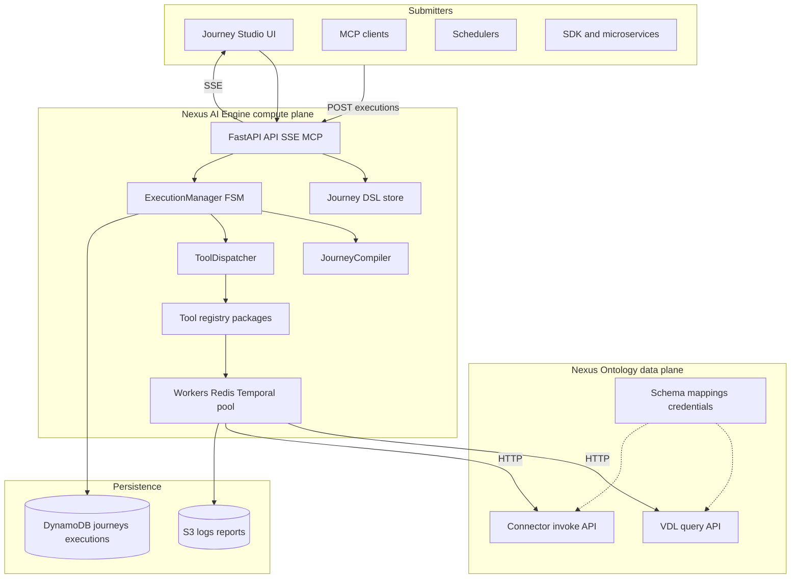

# nexus-ai-engine

**Nexus AI Engine** is the shared **compute plane** for running business and
operations workflows at scale. Operators and product teams define **journeys**
as declarative graphs; the engine compiles them, schedules work on a **worker
fleet**, and runs each step as a **registered tool**—with retries, approvals,
audit logs, and live progress—while **Nexus Ontology** stays the **data plane**
(VDL queries, connectors, schema, credentials).

Authoritative specs: [`docs/spec/README.md`](docs/spec/README.md) · operator
guide: [`docs/user-guide/`](docs/user-guide/) · delivery plan:
[`docs/dev-plan/000-master-plan.md`](docs/dev-plan/000-master-plan.md).

---

## Business overview

Enterprises want AI-assisted processes (order-to-cash, demand forecasting,
inventory risk, call-quality journeys) without letting every user prompt re-run
a full LLM “planner” on every batch. Nexus AI Engine turns those processes into
**versioned, reviewable journeys** that run like production software: predictable
cost, observable runs, and safe hand-off from copilot-assisted design to
unattended execution.

**Who uses it**

| Persona | How they interact |
|--------|-------------------|
| **Operations / domain owners** | Journey Studio UI — browse journeys, start runs, cancel/retry, schedules, queue health |
| **Platform / SRE** | Kubernetes deploy, worker scale, diagnostics, runbooks, DLQ |
| **Product engineers** | Publish **tool packages**, wire ontology VDL/Connector APIs, embed the library or HTTP API |
| **AI / copilot hosts** | Submit compiled journeys via REST, MCP, or SDK; monitor SSE |

The engine does **not** replace Ontology’s knowledge graph, mapping rules, or
connector vault. It **runs** what you defined once Ontology (or a copilot
session) produced a journey.

---

## Why it exists

It was **extracted from `nexus-backend`** so that:

1. **Execution scales independently** from the ontology UI and control-plane APIs.
2. **Many journeys run concurrently** on workers instead of inside a single API pod.
3. **Tool compute lives in the engine**; ontology services expose a thin **VDL +
   Connector** HTTP surface (see [041 Ontology Data Plane](docs/spec/041-ontology-data-plane-api.md)).
4. **The same executor semantics as nexus-sre** (FSM, graph scheduling, retries,
   verification) apply to **business DSL journeys**, not only infra remediation.

That split keeps credentials and schema in Ontology and keeps CPU-heavy tool runs
in a fleet that can autoscale on queue depth.

---

## Using it as an AI Engine (DAG workflow)

A **journey** is a **directed workflow**:

1. **Stages** form a **DAG** — each stage lists `depends_on: [other_stage_ids]`
   so phases like `entity_resolution` → `three_way_match` → `exceptions` run
   in order with explicit parallelism where allowed.
2. **Steps** inside a stage are compiled into an **ExecutionGraph** (shared
   contract with nexus-sre): sequential links, **parallel** fan-out, and
   **`foreach`** over structured items.
3. Each step names one **ReAct tool** from the **AI Engine tool registry** with
   fixed `params` (often binding outputs from earlier steps, e.g. `$opportunities`).

Typical lifecycle:

```text
Author journey (YAML/JSON DSL or Studio) → validate + version in store
    → submit execution (API / schedule / MCP)
    → JourneyCompiler → ExecutionGraph
    → ExecutionManager tick loop → ToolDispatcher → tools (nexus-tool-sdk → Ontology APIs)
    → logs/reports (S3) + SSE to UI
```

DSL details: [`docs/spec/010-journey-dsl.md`](docs/spec/010-journey-dsl.md) ·
executor tick loop: [`docs/spec/020-execution-engine.md`](docs/spec/020-execution-engine.md).

**Example shape** (simplified):

```yaml
apiVersion: nexus.ai/v1
kind: Journey
metadata:
  id: order-to-cash-monitor
  version: 3
spec:
  stages:
    - id: entity_resolution
      depends_on: []
      steps:
        - id: fetch_opportunities
          tool: query_virtual_entity
          params: { entity: Opportunity, limit: 500 }
    - id: three_way_match
      depends_on: [entity_resolution]
      steps:
        - id: match_lines
          tool: o2c_match_order_delivery_invoice
          params: { tolerance_pct: 0.01 }
```

---

## How this reduces token consumption

The engine is intentionally **not** an LLM inside the execution loop:

| Approach | Token / cost impact |
|----------|---------------------|
| **DSL authored or revised in design time** (human, Journey Studio, copilot) | The graph is stored and replayed; runtime does not re-plan with an LLM each run. |
| **Deterministic tool steps** | Each step is `tool` + `params`; workers call Python tools and Ontology APIs, not open-ended chat. |
| **Planner / copilot stays in Ontology** | Reasoning produces or edits a journey **once**; submitters hand a versioned definition to the engine. |
| **Structured step outputs** | Downstream steps consume JSON fields (`$item.foo`), avoiding huge narrative context in prompts. |
| **Versioned prompts catalog** | Prompt templates are managed via the prompts API/UI for tools that *do* call models—not re-embedded on every orchestration tick. |

Optional ReAct-style tools may still call an LLM **inside a single step**; the
engine bounds that to the step’s inputs/outputs and retry policy instead of
re-sending the full conversation history on every graph transition.

---

## Distributed jobs behind the agent

When a user (or copilot) **starts a journey**, the API records work and **worker
tiers** execute it off the request path:

| Tier | Role |
|------|------|
| **API** | Auth (host), journey CRUD, submit execution, SSE, queue snapshots |
| **Job queue** | Redis Streams (or compatible) admission, depth limits, DLQ, stale reclaim |
| **Workers** | `job_worker` pool runs transformation/DSL jobs; **Temporal** workers (`RunExecutionWorkflow`) provide durable ticks for production |
| **Tool runtime** | Loads published tool packages; calls Ontology over HTTP via `nexus-tool-sdk` |

Concurrency is first-class: global caps (`MAX_CONCURRENT_JOBS`), per-journey
`max_parallel_runs` / `max_parallel_steps`, and operator views (Queue,
Operations, fleet diagnostics) in the React frontend.

Spec: [`docs/spec/030-distributed-worker-runtime.md`](docs/spec/030-distributed-worker-runtime.md).

---

## Architecture



Deeper diagrams and deployment topology:
[`docs/spec/001-system-architecture.md`](docs/spec/001-system-architecture.md) ·
[`docs/spec/000-ai-engine-overview.md`](docs/spec/000-ai-engine-overview.md).

---

## Current state

| Area | Status (repo `backend/VERSION` tracks API; see `VERSION` at repo root) |
|------|--------|
| Journey DSL models, validator, **compiler → ExecutionGraph** | Shipped |
| **ExecutionManager**, FSM, tool dispatch, verification/retry hooks | Shipped (in-process + persistence paths) |
| Reference **FastAPI** server (journeys, jobs, queue, executions, prompts, diagnostics) | Shipped |
| **React Journey Studio** frontend (`frontend/`) | Shipped (evolving toward v0.3.0 GA scope) |
| DynamoDB / S3 adapters, local K3s dev workflow | Shipped |
| **Redis Streams job workers** (`job_worker`) | Shipped for queue-backed runs |
| **Temporal** worker entrypoints | Present; production hardening per [v0.2.0 distributed runtime](docs/dev-plan/releases/v0.2.0-distributed-runtime.md) |
| Tool packages + **nexus-tool-sdk** → Ontology VDL/Connector | In active use; registry model per [040](docs/spec/040-tool-registry-integration.md) |
| **v1.0.0** production GA (decouple legacy backend, full fleet UAT) | Planned — [master plan](docs/dev-plan/000-master-plan.md) |

**Stability:** Semver is past the original `0.1.0a1` extraction; APIs and contracts
are still tightening toward **v1.0.0**. Pin releases in production; see
[Integration guidelines](#integration-guidelines) and `docs/spec/ROUTE_PARITY.md`.

---

## What ships in this repo

- A **library core** (`nexus_ai_engine`) — journeys, executor, adapters, services.
- A **reference FastAPI + MCP server** (`nexus-ai-engine serve`) and **workers**.
- A **Journey Studio** React app and embedded UI assets in the Python package.
- An **importable testing harness** (`nexus_ai_engine.testing`) for in-process
  and HTTP-smoke tests without AWS (see [Testing](#testing)).

## Install

```bash
# From the internal Python index
pip install nexus-ai-engine

# Direct from GitHub (pin to a tag or main)
pip install "nexus-ai-engine @ git+https://github.com/nexusdataai/nexus-ai-engine.git@main"

# Editable, side-by-side with nexus-backend during development
pip install -e /path/to/nexus-ai-engine
```

Available extras:

```bash
pip install "nexus-ai-engine[aws]"      # boto3/botocore for the default adapters
pip install "nexus-ai-engine[server]"   # FastAPI + uvicorn + fastmcp + httpx
pip install "nexus-ai-engine[harness]"  # everything above + behave + pytest-benchmark
pip install "nexus-ai-engine[test,dev]" # full test + dev toolchain
```

## Layout

```
nexus-ai-engine/
├── backend/          # Python library + FastAPI reference server
├── frontend/         # Journey Studio React SPA (Vite)
├── deploy/k8s/       # Kubernetes manifests
├── docs/             # Specs, user guide, dev plans
├── scripts/          # K3s local dev helpers (port-forward, verify, legacy-deploy)
├── tests/            # Unit, integration, e2e, BDD
├── sdk/              # Tool SDK packages + sample journeys
├── VERSION           # Repo-level semver
└── Makefile          # Dev + deploy shortcuts
```

Core modules under `backend/src/nexus_ai_engine/`:

```
  config.py          # EngineConfig dataclass
  factory.py         # build_engine(config)
  contracts/         # Protocol ports, Pydantic models
  journeys/          # DSL validator, compiler, store
  executor/          # ExecutionManager, FSM, tool dispatcher
  adapters/          # DynamoDB, S3, in-memory
  server/            # Reference FastAPI app + MCP + CLI
  testing/           # Importable test harness
```

## Local development (simple)

In-memory engine — no AWS, no K3s:

```bash
make install-venv
source .venv/bin/activate
make serve                              # http://localhost:8000/health
```

Or via Docker (legacy local image build):

```bash
make docker-build && make docker-run    # http://localhost:8000/health
```

## K3s-backed local dev (recommended)

Run backend and frontend on the host with hot reload, connected to the K3s local stack (Scylla/MiniStack/MinIO + operator-managed resources). No Docker image rebuild for app code changes — same model as `nexus-ontology`.

### Prerequisites

1. K3s cluster and local AWS stack (from `nexus-deployer`):

```bash
cd ../nexus-deployer/aws-login && ./set-context.sh 6
cd ../nexus-deployer/kube-operator
./operator.sh deploy
cd ../local-k3s
./deploy-local-aws-stack.sh --kube-context local-cluster
./tests/verify-local-stack.sh --kube-context local-cluster
./tests/verify-local-boto3-apis.sh --kube-context local-cluster
```

2. Register the `ai-engine-local` namespace (operator or raw manifest):

```bash
# Required — use local K3s kubeconfig (not default ~/.kube EKS contexts)
source ../aws-login/.active-env
# Or: export KUBECONFIG=/path/to/nexus-deployer/aws-login/.kube/config

# Option A — operator product (registers namespace via NexusCapability CR)
./deploy-capability.sh --product local-ai-engine --env local

# Option B — apply deps manifest directly
kubectl --context local-cluster apply -f examples/nexus-ai-engine-local-dev-deps.yaml
```

If you see `the server has asked for the client to provide credentials`, kubectl is pointed at EKS instead of local K3s — run `source ../aws-login/.active-env` or `./set-context.sh 6` first.

3. Seed local DynamoDB tables and S3 buckets for ai-engine:

```bash
cd ../../nexus-ai-engine
make init-k3s-local-aws    # creates ai-engine-local-{journeys,executions,prompts} + buckets
```

Demo journeys are **not** stored in Scylla automatically. With K3s local dev the backend uses DynamoDB (`ai-engine-local-journeys`), which starts empty. On first startup the API seeds the 5 bundled demo journeys when `ENVIRONMENT=local` (disable with `SEED_DEMO_JOURNEYS=false`). To re-seed manually:

```bash
make seed-k3s-dev-journeys
# or: ./scripts/seed-sample-journeys.sh --base http://127.0.0.1:8000
```

### Daily workflow

```bash
# Terminal 1 — port-forwards (auto-started by make dev-backend if missing)
make port-forward-k3s      # or: make ensure-k3s-dev

# Terminal 2 — backend
cp backend/.env.local.k3s.example backend/.env.local   # once
make dev-backend           # uses .venv + unsets AWS_PROFILE

# Terminal 3 — frontend (start backend first)
cp frontend/.env.local.k3s.example frontend/.env.local   # once
make dev-frontend
```

| Service | Host endpoint |
|---------|---------------|
| Backend API | http://localhost:8000 |
| Frontend UI | http://localhost:8080 |
| DynamoDB (Scylla) | http://127.0.0.1:8001 |
| Athena/Glue (MiniStack) | http://127.0.0.1:4566 |
| S3 (MinIO) | http://127.0.0.1:9000 |

Verify:

```bash
make verify-k3s-dev
curl -sf http://127.0.0.1:8000/health
curl -sf http://127.0.0.1:8000/api/v1/journeys/ | head -c 200
```

Stop port-forwards: `make stop-port-forward-k3s`

**Important:** Do not reuse a prod-oriented `backend/.env.local` for K3s dev — use `backend/.env.local.k3s.example` (`CAPABILITY_NAME=ai-engine`, `ENVIRONMENT=local`). **Do not set `AWS_PROFILE=local`** when running the host backend; the Makefile unsets it and uses `minioadmin` keys from `.env.local`.

**Resource naming:** DynamoDB tables and S3 buckets follow `{capability}-{environment}-{purpose}` locally (e.g. `ai-engine-local-journeys`). Remote AWS uses legacy names via SSM (e.g. `ai-engine-journeys-dev`). Set only `CAPABILITY_NAME` and `ENVIRONMENT` — do not hardcode table names unless overriding a single resource.

Port-forward PID file: `.k3s-port-forward-ai-engine.pids` (separate from ontology’s PID file).

## Deploy (kube-operator)

```bash
cd ../nexus-deployer/kube-operator
./bump-version.sh ai-engine-all patch --ai-engine-dir ../../nexus-ai-engine
./package-images.sh --only-ai-engine-images --ai-engine-dir ../../nexus-ai-engine
./create-ecr-images.sh --only-ai-engine-images
./app-rollout.sh --capability ai-engine --env dev --version <tag> ai-engine-all
```

Or from this repo:

```bash
make deploy-dev
```

## Images

| Component | ECR repository | K8s deployment |
|-----------|----------------|----------------|
| API | `nexus-ai-engine-api` | `nexus-ai-engine` |
| UI | `nexus-ai-engine-ui` | `nexus-ai-engine-ui` |

Namespace: `ai-engine-{env}` (e.g. `ai-engine-dev`, `ai-engine-prod`; prod uses `ai-engine`).

Legacy standalone EKS deploy (IAM, CloudFormation, `deploy-and-test.sh`): [scripts/legacy-deploy/README.md](scripts/legacy-deploy/README.md).

---

Health/readiness/version plus journey/job/queue/execution/logs/reports/prompts
routes are exercised in CI and local K3s against in-memory and DynamoDB-backed
configs. See [docs/spec/ROUTE_PARITY.md](docs/spec/ROUTE_PARITY.md) for the
canonical HTTP surface.

## Embedded journey studio UI

The reference server ships a small React UI bundled inside the Python
package. Open it with `kubectl port-forward` — no ingress, no auth, no
build tooling:

```bash
# Local dev
make serve
open http://localhost:8001/ui

# Deployed pod
kubectl -n ai-engine port-forward svc/nexus-ai-engine 8000:8000
open http://localhost:8000/ui
```

What you can do:

- Browse the 5 seeded journeys (order-to-cash, call-processing,
  demand-forecasting, inventory-optimization, supply-chain-risk) with
  search, filters, and per-journey KPIs.
- Open a **Journey Studio** to view stages + steps and click
  **Start Processing** to kick off a simulated job; live progress streams
  via SSE into a logs drawer.
- Inspect job history, **Cancel** running jobs, **Retry** failed ones.
- Manage **Batch Schedules** — create, toggle, delete, Run Now.
- Edit the **prompts catalog** with a version-history audit log and a
  one-click reset to defaults.

See [docs/spec/UI.md](docs/spec/UI.md) for the architecture, component tree, and how
to add pages or API routes.

## Integration guidelines

`nexus-ai-engine` is designed to be embedded in three different shapes. Pick
the one that matches your host application; the underlying core is the same.

| Mode | Best for | Install | Coupling |
|------|----------|---------|----------|
| 1. Embed as a Python library | Apps that already host their own framework and want direct service calls | `nexus-ai-engine[aws]` | Tightest — single process |
| 2. Mount the FastAPI routers in your app | Apps using FastAPI that want the journey/job/prompts HTTP surface "for free" | `nexus-ai-engine[server,aws]` | Same process, separate URL prefix |
| 3. Run as an independent pod / microservice | Polyglot fleets, language-agnostic clients, multi-tenant isolation | Docker image / `[server]` extra | HTTP boundary |
| 4. Connect via MCP | LLM clients (Claude Desktop, Cursor, custom MCP hosts) | `[server]` extra (phase 7+) | stdio / HTTP MCP |
| 5. Use the harness in your own tests | Anyone — the harness is import-safe at any time | `nexus-ai-engine[harness]` | Test-time only |

Modes 1–3 and 5 are usable today against the reference server and K3s
deployments. MCP (mode 4) is available on the server CLI; confirm tool parity
for your client in [ROUTE_PARITY.md](docs/spec/ROUTE_PARITY.md).

### Mode 1 — Embed as a Python library

For apps that want to call services directly without HTTP overhead.

```python
# your_app/bootstrap.py
from nexus_ai_engine.config import EngineConfig
from nexus_ai_engine.factory import build_engine

config = EngineConfig(
    region="us-east-1",
    role_arn="arn:aws:iam::123456789012:role/your-engine-role",
    dynamodb_transformation_table="prod-transformation",
    dynamodb_prompts_table="prod-prompts",
    s3_journey_logs_bucket="prod-journey-logs",
    s3_journey_reports_bucket="prod-journey-reports",
    max_concurrent_jobs=20,
)

engine = build_engine(config)

# Services are available on the built engine object (exact surface varies by release):
#   journey_id = await engine.journeys.create(...)
#   job_id     = await engine.jobs.run(...)
#   logs       = await engine.logs.get(...)
```

Custom domain stages register at startup via the stage registry (activates
phase 8):

```python
from nexus_ai_engine.stages import register_stage
from your_app.stages import MyCustomStage

register_stage("my_custom_stage", MyCustomStage)
```

### Mode 2 — Mount the FastAPI routers in your app

For host apps that already run FastAPI (e.g. nexus-backend itself in
phase 10+). Use the library's routers under their canonical prefixes;
add your own auth, rate-limiting, and observability middleware on top.

```python
# your_app/main.py
from fastapi import FastAPI

from nexus_ai_engine.factory import build_engine
from nexus_ai_engine.config import EngineConfig
from nexus_ai_engine.server.app import (
    JOURNEYS_PREFIX,
    PROMPTS_PREFIX,
)
from nexus_ai_engine.server.routers import (
    health,
    journeys,
    jobs,
    logs,
    reports,
    prompts,
)

app = FastAPI(title="Your App")

# Your own auth middleware FIRST — the library does not ship auth
app.add_middleware(YourCognitoAuthMiddleware)

# Then mount the engine routers
app.include_router(health.router, tags=["health"])
app.include_router(journeys.router, prefix=JOURNEYS_PREFIX, tags=["journeys"])
app.include_router(jobs.router,     prefix=JOURNEYS_PREFIX, tags=["jobs"])
app.include_router(logs.router,     prefix=JOURNEYS_PREFIX, tags=["logs"])
app.include_router(reports.router,  prefix=JOURNEYS_PREFIX, tags=["reports"])
app.include_router(prompts.router,  prefix=PROMPTS_PREFIX,  tags=["prompts"])

@app.on_event("startup")
async def _wire_engine() -> None:
    app.state.engine = build_engine(EngineConfig(...))
```

The reference server's `create_app(engine)` does the same wiring for you if
you don't need to interleave with other routers — see
`nexus_ai_engine.server.create_app`.

### Mode 3 — Run as an independent pod / microservice

Already wired end-to-end. Build the image, deploy the manifests, talk to it
over HTTP. See the [Deployment as an independent pod](#deployment-as-an-independent-pod)
section below. Calls from another service:

```python
import httpx

NEXUS = "http://nexus-ai-engine.nexus-ai-engine-dev.svc.cluster.local:8000"

async def list_journeys() -> list[dict]:
    async with httpx.AsyncClient(base_url=NEXUS) as client:
        resp = await client.get("/api/v1/journeys/")
        resp.raise_for_status()
        return resp.json()
```

Health probes for Kubernetes / your load balancer:

| Endpoint     | Use as                |
|--------------|-----------------------|
| `/health`    | liveness probe        |
| `/readiness` | readiness probe       |
| `/version`   | deployment audit      |

### Mode 4 — Connect via MCP

The reference server can expose MCP tools (journey, logs/reports, and related
surfaces—see [ROUTE_PARITY](docs/spec/ROUTE_PARITY.md)) so clients such as
Claude Desktop or Cursor can submit and inspect runs without custom HTTP glue:

```bash
# stdio (Claude Desktop, Cursor)
nexus-ai-engine serve --mcp-stdio

# HTTP MCP (other hosts)
nexus-ai-engine serve --mcp-http --port 9000
```

Configure your MCP client to invoke the binary or hit the HTTP endpoint
exactly as it would for nexus-backend's MCP server today.

### Mode 5 — Use the harness in your own tests

Any project depending on `nexus-ai-engine[harness]` automatically picks up
the shipped pytest fixtures (registered via the `pytest11` entry point):

```python
# your_project/tests/test_my_journey.py
import pytest

@pytest.mark.asyncio
async def test_my_journey_runs(http_client, journey_runner, samples_dir):
    # 1. Hit the in-process FastAPI harness
    health = await http_client.get("/health")
    assert health.status_code == 200

    # 2. Run a plugin-journey YAML end-to-end (phase 9+)
    result = journey_runner.run(samples_dir / "my_journey.yaml")
    assert result.ok
```

The harness factories are also usable directly (no pytest required):

```python
from nexus_ai_engine.testing import (
    JourneyYAMLRunner,
    TestHttpClient,
    make_test_app,
    make_test_engine,
)

app = make_test_app()
async with TestHttpClient(app) as client:
    resp = await client.get("/api/v1/journeys/")
```

`TestHttpClient(base_url="https://nexus-ai-engine-dev....")` works the same
way against a real deployed pod, so the same test code runs in-process for
CI and against staging for smoke checks.

### Configuration contract

All configuration flows through `EngineConfig` ([backend/src/nexus_ai_engine/config.py](backend/src/nexus_ai_engine/config.py)).
The library never reads environment variables itself; consumers build the
dataclass from whichever source they prefer (env, SSM, Secrets Manager,
Kubernetes ConfigMap, app config file).

The reference server's CLI does read env vars as a convenience; the
authoritative names are:

| Env var | EngineConfig field | Required by phase |
|---------|--------------------|-------------------|
| `AWS_REGION`                       | `region`                          | 5+ |
| `AWS_ROLE_ARN`                     | `role_arn`                        | optional |
| `DYNAMODB_TRANSFORMATION_TABLE`    | `dynamodb_transformation_table`   | 7 |
| `DYNAMODB_PROMPTS_TABLE`           | `dynamodb_prompts_table`          | 5 |
| `S3_JOURNEY_LOGS_BUCKET`           | `s3_journey_logs_bucket`          | 6 |
| `S3_JOURNEY_REPORTS_BUCKET`        | `s3_journey_reports_bucket`       | 6 |
| `MAX_CONCURRENT_JOBS`              | `max_concurrent_jobs`             | 7 |

For local dev, use in-memory adapters or K3s-backed DynamoDB (see
[K3s-backed local dev](#k3s-backed-local-dev-recommended)). Production requires
table and bucket names in `EngineConfig`.

### Choose your storage adapters

The shipped adapters live under `backend/src/nexus_ai_engine/adapters/` and are
selected via `build_engine(...)` overrides (lands in phase 3):

- **DynamoDB + S3 (default).** Enable `[aws]` extra; pass real table/bucket
  names in `EngineConfig`. Item layout matches nexus-backend so no data
  migration is needed when swapping the backend in phase 10.
- **In-memory.** Used by the harness; suitable for tests and local prototyping.
  No AWS dependency.
- **Custom.** Implement the Protocols in `nexus_ai_engine.contracts` and
  inject them into `build_engine` (e.g. Postgres-backed `JourneyRepository`,
  filesystem `LogSink`, Redis `EventSink`). Each port is small (5–10 methods)
  and documented in the module docstring once it lands.

### Auth, observability, multi-tenancy

These are intentionally **out of scope** for the library:

- **Auth.** No middleware. Add Cognito / OAuth / RBAC in your host app
  (mode 2) or as an ingress concern (mode 3). The library trusts the caller.
- **Multi-tenancy.** The journey/job key layout (`JOURNEY#{id}`,
  `JOB#{order}#{stage}#...`) does not currently include a tenant prefix.
  If you need hard tenant isolation, prefix `journey_id` in your host app
  before calling the library, or supply a tenant-aware adapter via the
  custom-adapter route.
- **Observability.** The library logs via `loguru` and emits SSE through
  `SSEManager`. Wire your tracer / metrics / log shipper in the host process;
  the library makes no global modifications.
- **SSE multi-pod limitation.** `SSEManager` is in-process. If you scale
  beyond one pod **and** rely on SSE, route SSE traffic with sticky sessions
  or replace `EventSink` with a Redis-backed adapter (custom adapter route).

### Versioning policy

- Release lines follow [`docs/dev-plan/`](docs/dev-plan/README.md) (v0.2.x … v1.0.0).
- Pin **image tags** and **Python package versions** in production until v1.0.0 GA.
- Pre-1.0 minors may include contract adjustments; run `make test-all` when upgrading.

See [Current state](#current-state) above; [`CHANGELOG.md`](CHANGELOG.md) when present for release notes.

## Testing

The library is tested in complete isolation from nexus-backend and AWS — no
credentials, no network, no backend process required. See
[tests/README.md](tests/README.md) for the full tier guide.

```bash
make install-venv && source .venv/bin/activate
make test                # unit tests (<5s)
make test-all            # every tier (unit + integration + contract + property + e2e + journeys + bdd + endurance-smoke)
make coverage            # branch coverage with a 60% floor (ratcheting up per phase)
make journey             # run a sample plugin-journey YAML end-to-end
```

Tiered test directories:

- `tests/unit/`        fast Python-only tests
- `tests/integration/` moto-backed AWS adapter tests
- `tests/contract/`    parametrized across adapter implementations
- `tests/property/`    hypothesis state-machine tests
- `tests/e2e/`         in-process `httpx.AsyncClient` against the reference FastAPI app
- `tests/bdd/`         behave scenarios against the in-process harness
- `tests/endurance/`   concurrent load smoke (heavy scenarios opt-in)
- `tests/journeys/`    plugin-journey YAMLs exercised end-to-end

## Legacy EKS deploy

Standalone manifests under `deploy/k8s/` plus IAM/CloudFormation scripts live under `scripts/legacy-deploy/`. See [scripts/legacy-deploy/README.md](scripts/legacy-deploy/README.md) for the full playbook (admin IAM setup, `deploy-and-test.sh`, port-forward, in-pod tests, tear-down).

## Development

```bash
make install-venv         # create .venv and install with all extras
source .venv/bin/activate
make watch                # TDD watch mode on unit tests
make lint                 # ruff
make typecheck            # mypy
make all                  # pre-push gate: clean + lint + typecheck + test-all + coverage + build
```

## License

MIT. See [LICENSE](LICENSE).
