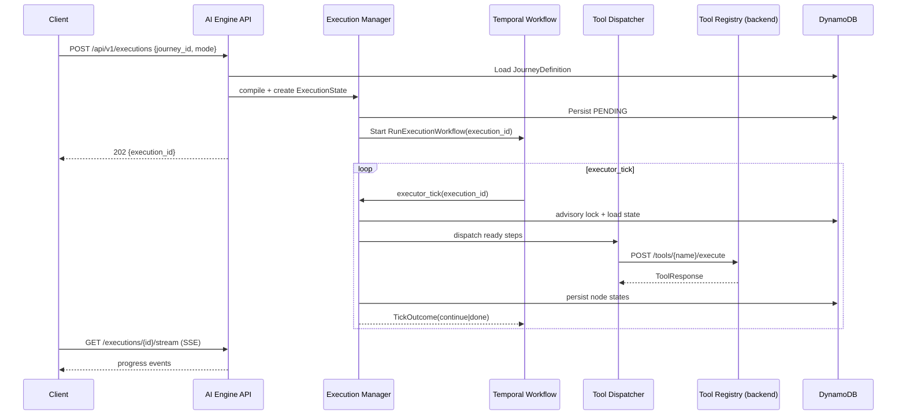

# 001 — System Architecture

**Version:** 0.2.0  
**Status:** Draft  

---

## Architecture Principles

1. **Executor owns orchestration** — same ADR-001 split as nexus-sre; no LLM in the tick loop
2. **Domain-organized monorepo** — backend + frontend + sdk + helm (mirror nexus-sre)
3. **Ports and adapters** — hexagonal; DynamoDB/S3/Temporal/ToolRegistry are swappable
4. **Deterministic given DSL + registry + policies** — replays must be reproducible
5. **Submit many, run many** — concurrency is a first-class control plane concern

---

## Logical Architecture

```text
                         ┌──────────────────────────────────┐
                         │         Control Plane            │
                         │  (nexus-backend — optional peer)   │
                         │  ToolRegistry · PolicyEngine       │
                         │  CopilotEngine (plans journeys)    │
                         └───────────────┬──────────────────┘
                                         │ tools HTTP
┌──────────────┐    REST/SSE/MCP        │
│ Journey      │◄───────────────────────┤
│ Studio UI    │                        │
└──────┬───────┘                        │
       │                                ▼
       │              ┌─────────────────────────────────────────┐
       └─────────────►│           AI Engine API Layer            │
                      │  FastAPI routers · auth headers · SSE    │
                      └─────────────────┬───────────────────────┘
                                        │
                      ┌─────────────────▼───────────────────────┐
                      │           Application Services           │
                      │  JourneyService · ExecutionService       │
                      │  ScheduleService · PromptsService        │
                      └─────────────────┬───────────────────────┘
                                        │
          ┌─────────────────────────────┼─────────────────────────────┐
          ▼                             ▼                             ▼
┌──────────────────┐        ┌──────────────────┐        ┌──────────────────┐
│ Execution Manager│        │  DSL Compiler    │        │  Event Publisher │
│ (tick loop)      │        │  Journey→Graph   │        │  SSE + optional  │
└────────┬─────────┘        └──────────────────┘        │  NATS/Kafka      │
         │                                               └──────────────────┘
         │
    ┌────┴────┬────────────┬────────────┬────────────┐
    ▼         ▼            ▼            ▼            ▼
 Approval  Retry      Verification  Rollback    Tool
 Engine    Engine     Engine        Engine     Dispatcher
    │         │            │            │            │
    └─────────┴────────────┴────────────┴────────────┘
                              │
                              ▼
                    ┌──────────────────┐
                    │  Worker Runtime   │
                    │  Temporal + Pool  │
                    └─────────┬─────────┘
                              │
              ┌───────────────┼───────────────┐
              ▼               ▼               ▼
         DynamoDB            S3          nexus-backend
      (state, journeys)   (logs, reports)  /control-plane/tools
```

---

## Physical Deployment

```text
┌──────────────── Kubernetes namespace: ai-engine ─────────────────┐
│                                                                   │
│  Ingress (optional) ──► nexus-ai-engine-ui (nginx static)        │
│                    └──► nexus-ai-engine-api (FastAPI :8000)    │
│                                                                   │
│  nexus-ai-engine-workers (Deployment, HPA)                       │
│    entrypoint: python -m nexus_ai_engine.worker.main             │
│    pulls: nexus-ai-execution task queue                          │
│                                                                   │
│  ConfigMap · ServiceAccount (IRSA) · NetworkPolicy · HPA         │
└───────────────────────────────────────────────────────────────────┘
         │                              │
         ▼                              ▼
   DynamoDB tables                  S3 buckets
   ai-engine-journeys-{env}         ai-engine-journeys-logs-{env}
   ai-engine-executions-{env}       ai-engine-journeys-reports-{env}
   ai-engine-prompts-{env}
```

Mirrors nexus-sre Helm split:

| nexus-sre | nexus-ai-engine |
|-----------|-----------------|
| `deployment-backend.yaml` | `deployment-api.yaml` |
| `deployment-ui.yaml` | embedded in API wheel OR separate `frontend/` build |
| `deployment-workers.yaml` | `deployment-workers.yaml` |
| PostgreSQL | DynamoDB |
| NATS events | SSE (+ optional NATS later) |

---

## Request Flow: Submit Journey Execution



---

## Integration Topology

### nexus-backend (Tool Registry)

| Direction | Protocol | Purpose |
|-----------|----------|---------|
| AI Engine → Backend | HTTP | `GET /api/v1/control-plane/tools`, `POST .../tools/{name}/execute` |
| Backend → AI Engine | HTTP | Submit journey executions, poll status |
| MCP clients → AI Engine | MCP stdio/HTTP | Journey CRUD, run management |

Tool dispatch **must** pass through caller context:

```json
{
  "arguments": { "...": "..." },
  "context": {
    "tenant_id": "...",
    "user_id": "...",
    "execution_id": "...",
    "step_id": "...",
    "idempotency_key": "..."
  }
}
```

Backend `PolicyEngine` enforces risk gates using this context.

### nexus-sre (peer executor)

No direct runtime coupling. Shared **contracts** only:

- `ExecutionGraph`, `ExecutionState`, `ToolRequest`/`ToolResponse` shapes
- Event naming conventions (prefixed `nexus.ai.*` vs `nexus.sre.*`)

Future: unified observability dashboard may federate both APIs.

---

## Concurrency Model

| Level | Control | Default |
|-------|---------|---------|
| **Global** | `max_concurrent_executions` in EngineConfig | 50 |
| **Per journey** | `spec.concurrency.max_parallel_runs` | 1 |
| **Per stage** | `stage.max_parallelism` | 4 |
| **Per step** | `step.can_parallel`, `foreach` expansion | graph-derived |

Worker pool sizing:

```
worker_replicas = ceil(in_flight_executions / target_executions_per_worker)
```

HPA metric: `nexus_ai_engine_execution_queue_depth` (Prometheus).

---

## Failure Domains

| Failure | Behavior |
|---------|----------|
| Worker crash | Temporal retries `executor_tick`; state from DynamoDB |
| Tool timeout | Retry per step policy; then stage fail |
| Tool policy violation | Step FAILED; execution AWAITING_APPROVAL or FAILED |
| Backend unreachable | Circuit breaker; executions pause with reason |
| DynamoDB throttling | Exponential backoff on persistence layer |

---

## Security

- **No secrets in DSL** — use `{secret_ref: "arn:..."}` resolved at dispatch
- **Identity passthrough** — `X-Nexus-Tenant`, `X-Nexus-User` headers from ingress
- **IRSA** for DynamoDB/S3 access from pods
- **NetworkPolicy** deny-all ingress except kube-system + API service mesh
- **Tool risk classes** enforced by backend PolicyEngine (engine does not bypass)

---

## Observability

| Signal | Mechanism |
|--------|-----------|
| Logs | structlog → CloudWatch / Loki |
| Metrics | Prometheus: executions_active, steps_total, tool_latency |
| Traces | OpenTelemetry: execution_id as trace root |
| Audit | DynamoDB `AUDIT#` items + S3 immutable reports |
| Live UI | SSE per execution / per stage run |
