# Nexus AI Engine Scrum Master Plan

## Purpose

Single top-level plan for building Nexus AI Engine from **v0.1.0a1** (extracted
library + embedded JSX UI) to **v1.0.0** (standalone production execution
service). Every sprint plan, release plan, UAT doc, and user-guide chapter
references this document for sequencing.

## Architecture anchor (locked)

| Layer | Responsibility |
|---|---|
| **AI Engine** | Tool registry, tool execution, journey DSL, distributed workers, Journey Studio |
| **Ontology** (nexus-backend → nexus-ontology) | VDL API, Connector API, schema, credentials — **no production journey execution** |
| **Submitters** | Ontology Copilot UI, schedulers, MCP, SDK |

See `docs/spec/040-tool-registry-integration.md` and
`docs/spec/041-ontology-data-plane-api.md`.

## Sprint cadence

- **Length:** 2 weeks
- **Start:** Monday **2026-08-04**
- **Total:** 14 sprints ending **2027-02-26**
- **Team size:** 4 engineers (Executor/Platform: 2, Frontend: 1, Ontology integration: 1 part-time from sprint 7)

## Release-to-sprint mapping

| Release | Sprints | Dates | GA cut | Theme |
|---|---|---|---|---|
| **v0.2.0-alpha Foundation** | 1 – 2 | 2026-08-04 → 2026-08-28 | 2026-08-28 | Contracts, monorepo, embedded UI hardening |
| **v0.2.0-beta Journey DSL** | 3 – 4 | 2026-08-31 → 2026-09-25 | 2026-09-25 | DSL models, compiler, journey CRUD |
| **v0.2.0-rc1 Execution Engine** | 5 – 6 | 2026-09-28 → 2026-10-23 | 2026-10-23 | FSM, ExecutionManager, mock tool dispatch |
| **v0.2.0-rc2 Tool Platform** | 7 – 8 | 2026-10-26 → 2026-11-20 | 2026-11-20 | nexus-tool-sdk, tool packages, ontology VDL/Connector |
| **v0.2.0 Distributed Runtime** | 9 – 10 | 2026-11-23 → 2026-12-18 | 2026-12-18 | DynamoDB, Temporal workers, Executions API + SSE |
| **v0.3.0 Journey Studio** | 11 – 12 | 2027-01-05 → 2027-01-30 | 2027-01-30 | React SPA, fleet monitor, DSL editor |
| **v1.0.0 Production GA** | 13 – 14 | 2027-02-02 → 2027-02-26 | 2027-02-26 | Backend decoupling, hardening, prod UAT |

Holiday buffer: no sprint **2026-12-21 → 2027-01-02** (between v0.2.0 and v0.3.0).

## Master sprint index

| # | Sprint | Release | Theme | Spec anchors |
|---|---|---|---|---|
| 01 | Contracts & monorepo scaffold | α | Pydantic contracts, `backend/` layout, CI | `002`, `050`, `060` |
| 02 | Embedded UI + operator plumbing + **α GA** | α | UI parity, kube-operator, UAT α, user guide ch.1 | `070`, `UI.md`, `040` |
| 03 | Journey DSL models + validator | β | Pydantic DSL, semantic validation | `010` |
| 04 | DSL compiler + journey service + **β GA** | β | DSL → ExecutionGraph, CRUD API, UAT β | `010`, `090` |
| 05 | ExecutionManager + FSM core | rc1 | Tick loop, state machine | `020`, `021` |
| 06 | ToolDispatcher mock + legacy bridge + **rc1 GA** | rc1 | In-process tools, stage adapter, UAT rc1 | `020`, `040` |
| 07 | nexus-tool-sdk + Tool registry | rc2 | VdlClient, ConnectorClient, Tool base | `040`, `041` |
| 08 | Tool packages + ontology wiring + **rc2 GA** | rc2 | Publish API, O2C package migrate, UAT rc2 | `040`, `041` |
| 09 | DynamoDB execution storage | v0.2.0 | Execution repo, locks, migration | `050` |
| 10 | Temporal workers + Executions API + **v0.2.0 GA** | v0.2.0 | SSE, batch submit, UAT v0.2.0 | `030`, `060` |
| 11 | Frontend shell + journey list/detail | v0.3.0 | Vite SPA, dashboard, executions monitor | `070`, `002` |
| 12 | Journey Studio editor + tools catalog + **v0.3.0 GA** | v0.3.0 | DSL editor, SSE live graph, UAT v0.3.0 | `070` |
| 13 | nexus-backend decoupling + observability | v1.0.0 | Copilot submits to engine, Grafana | `001`, `080` phase 10 |
| 14 | Load test + security + **v1.0.0 GA** | v1.0.0 | 500 concurrent, pen test, prod UAT | `080` |

## Cross-release dependencies

```mermaid
flowchart LR
  S1[S1 contracts] --> S2[S2 alpha GA]
  S2 --> S3[S3 DSL models]
  S3 --> S4[S4 compiler beta GA]
  S4 --> S5[S5 executor FSM]
  S5 --> S6[S6 rc1 GA]
  S6 --> S7[S7 tool-sdk]
  S7 --> S8[S8 rc2 GA]
  S8 --> S9[S9 dynamodb]
  S9 --> S10[S10 v0.2.0 GA]
  S10 --> S11[S11 SPA shell]
  S11 --> S12[S12 v0.3.0 GA]
  S12 --> S13[S13 decouple]
  S13 --> S14[S14 v1.0.0 GA]
```

## Per-release deliverables (always)

Every release cut **must** include:

| Gate | Artifact | Location |
|---|---|---|
| UAT plan written | Before sprint 1 of release | `docs/delivery/NNN-<release>-uat.md` |
| UAT executed | Final sprint of release | Sign-off matrix in UAT doc |
| User guide updated | Final sprint of release | `docs/user-guide/` |
| Build plan | Sprint planning | `docs/dev-plan/build/` + `.cursor/plans/` |
| Version bump + rollout | GA sprint | kube-operator pipeline |

## Success metrics (v1.0.0)

| Metric | Target |
|---|---|
| Concurrent executions | 500+ |
| Submit → first step p99 | < 5 s |
| Tool dispatch p99 (in-cluster VDL) | < 30 s |
| Crash recovery | 100% resumable |
| UI live update latency (SSE) | < 2 s |
| Executor test coverage | ≥ 90% |
| UAT P0 pass rate | 100% per release |

## Cross-references

- `docs/spec/080-implementation-roadmap.md`
- `docs/dev-plan/020-sprint-calendar.md`
- `docs/dev-plan/releases/` — detailed release plans
- `docs/user-guide/000-user-guide-index.md`
