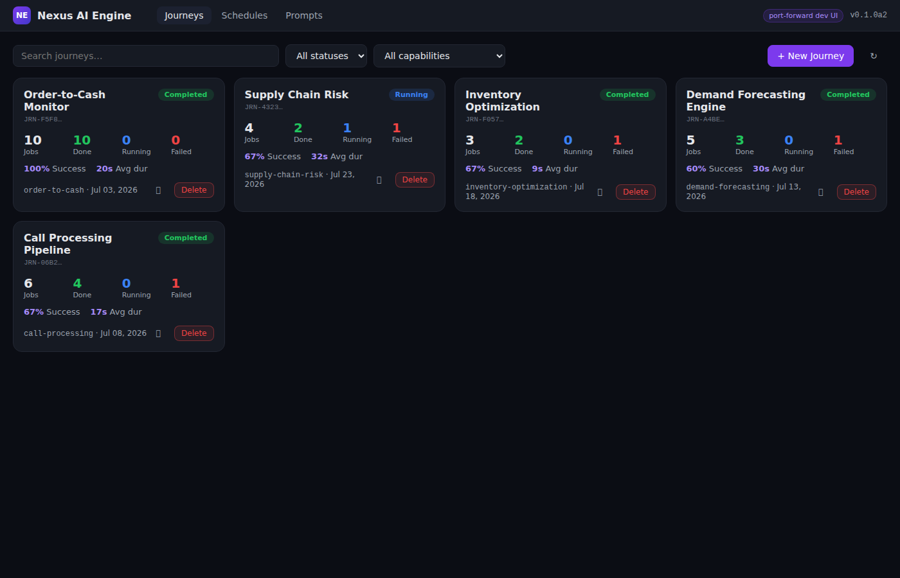
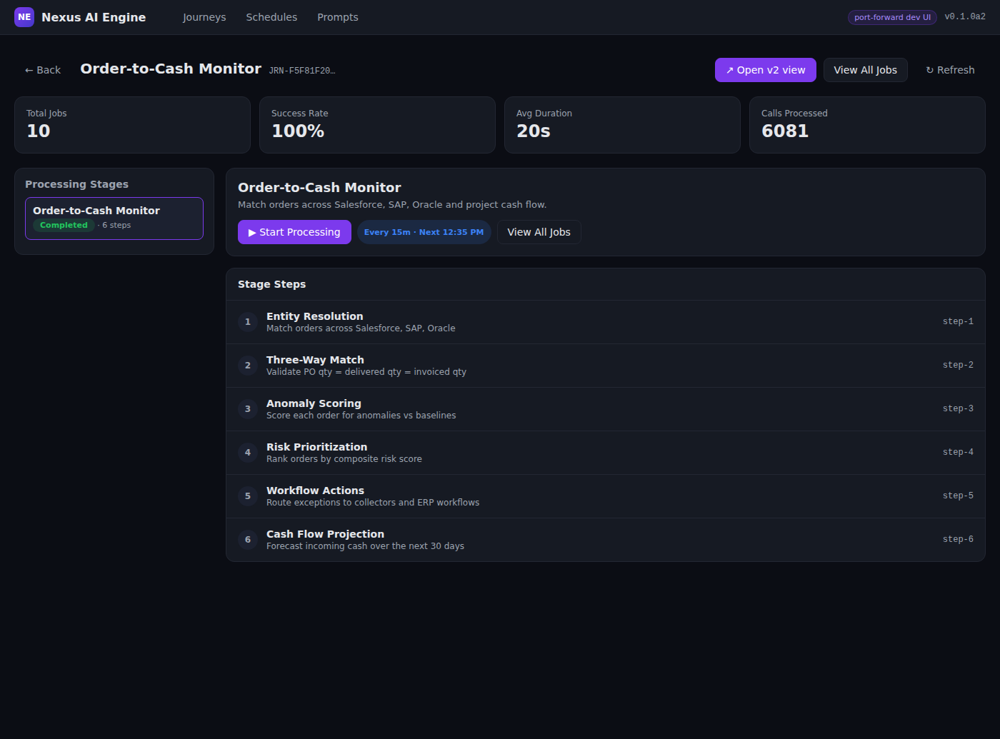
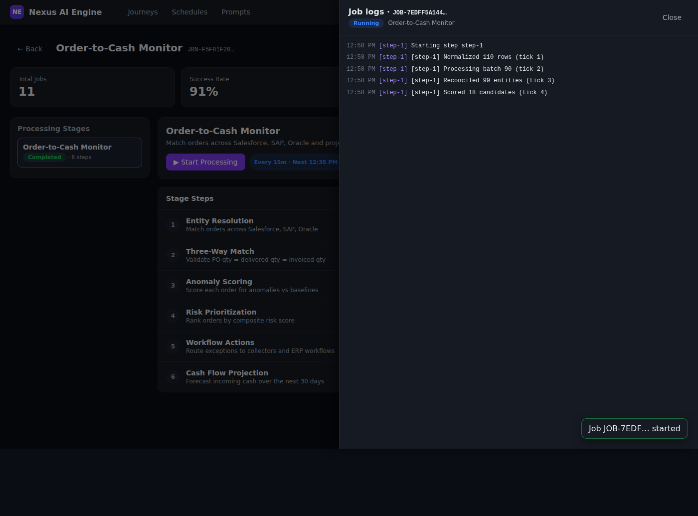
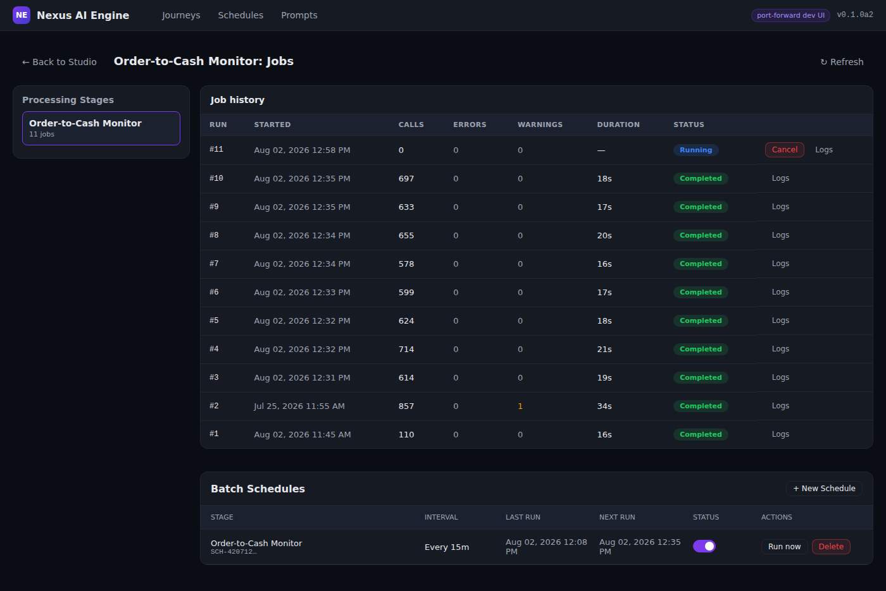
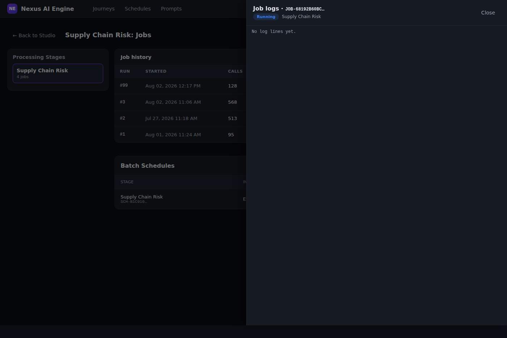

# Chapter 2 — Embedded Dev UI

**Release:** v0.2.0-alpha  
**Status:** Accepted (Sprint 2)  
**UAT:** α-G2 (guide), α-U1–α-U5 (UI scenarios)

## Purpose

The embedded **Journey Studio** UI ships inside the reference FastAPI server at
`/ui`. It is intended for **local development** and **kubectl port-forward**
testing — not for production operators (production monitoring arrives in v0.2.0
Executions API and v0.3.0 Journey Studio SPA).

This chapter walks through the five UAT UI scenarios (α-U1–α-U5) with
screenshots captured from `make serve` on port **8001**.

## Prerequisites

Complete [Chapter 1 — Getting Started](./01-getting-started.md) first:

- Local: `make serve` → [http://localhost:8001/ui](http://localhost:8001/ui)
- Cluster: `kubectl port-forward -n ai-engine-prod svc/nexus-ai-engine-api 8001:8000`

The UI reads the same `/api/v1/*` routes whether local or port-forwarded.

---

## Navigation overview

| Hash route | Page | UAT |
|------------|------|-----|
| `#/` | Journeys grid | α-U1 |
| `#/journey/{id}` | Journey Studio (stages + steps) | α-U2, α-U3 |
| `#/journey/{id}/jobs` | Job history + schedules | α-U4, α-U5 |
| `#/schedules` | Cross-journey schedules | — |
| `#/prompts` | Prompt catalog | — |

Top bar shows **Journeys**, **Schedules**, **Prompts**, a `port-forward dev UI`
badge, and the server version from `/version`.

---

## α-U1 — Journeys grid

**Goal:** Confirm the UI loads and lists seeded demo journeys.

1. Open [http://localhost:8001/ui](http://localhost:8001/ui) (or `#/`).
2. Verify the top bar shows **Nexus AI Engine** and version (e.g. `v0.1.0a2`
   pre–release-cut; becomes `v0.2.0-alpha` after release tag).
3. Confirm **five journey cards** appear:
   - Order-to-Cash Monitor
   - Call Processing Pipeline
   - Demand Forecasting Engine
   - Inventory Optimization
   - Supply Chain Risk
4. Try the **Search journeys…** box and **status / capability** filters.



**Automated check:** `pytest tests/e2e/test_ui_static.py -q`

---

## α-U2 — Journey detail (Order-to-Cash)

**Goal:** Open a journey and confirm the stage sidebar shows **6 steps**.

1. On the journeys grid, click **Journey Studio** on **Order-to-Cash Monitor**
   (or navigate to `#/journey/JRN-F5F81F203D` — ID varies by seed; use the card
   in your session).
2. Confirm the KPI row: **Total Jobs**, **Success Rate**, **Avg Duration**,
   **Calls Processed**.
3. In the **Processing Stages** sidebar, select **Order-to-Cash Monitor**.
4. Verify the stage shows **6 steps**:
   - Entity Resolution
   - Three-Way Match
   - Anomaly Scoring
   - Risk Prioritization
   - Workflow Actions
   - Cash Flow Projection



**Tip:** **↗ Open v2 view** launches a GitHub-Actions-style live progress layout
(preview). **View All Jobs** jumps to job history (α-U4).

**Automated check:** `pytest tests/e2e/test_journey_ui_api.py -k o2c -q`

---

## α-U3 — Start Processing (simulated job)

**Goal:** Trigger a stage run and observe job lifecycle.

1. Stay on (or return to) the **Order-to-Cash Monitor** journey detail.
2. Click **▶ Start Processing**.
3. A toast confirms the new job ID; the **logs drawer** opens automatically with
   live SSE events (`step_status`, `task_progress`, `job_complete`).
4. Watch step progress advance through the simulated pipeline (~25 s total).
5. When complete, the drawer shows a terminal status pill (**completed**).



**API equivalent:**

```bash
curl -sf -X POST "http://localhost:8001/api/v1/journeys/JRN-F5F81F203D/jobs" \
  -H 'Content-Type: application/json' \
  -d '{"stage_id":"order_to_cash","triggered_by":"api","reason":"manual test"}' | jq .
```

**Automated check:** `pytest tests/e2e/test_run_and_observe_job.py -q`

---

## α-U4 — Job history table

**Goal:** View past and running jobs for a journey.

1. From journey detail, click **View All Jobs**
   (`#/journey/{id}/jobs`).
2. Confirm the **Job history** table lists runs with:
   - Run number, started time, calls, errors, warnings, duration, status
3. Use the **Processing Stages** sidebar to filter by stage.
4. For a **running** job, **Cancel** is available; for **failed**, **Retry**.



**Supply Chain Risk** is pre-seeded with a **running** job (run #99) for α-U5.

**Automated check:** `pytest tests/e2e/test_ui_route_parity.py -k jobs -q`

---

## α-U5 — SSE logs drawer (running job)

**Goal:** Open logs on an in-flight job and confirm streaming events.

1. Open **Supply Chain Risk** → **View All Jobs**
   (`#/journey/JRN-4323664EC6/jobs`).
2. Locate run **#99** with status **Running** (seeded demo job).
3. Click **Logs** (or click the row) to open the **Job logs** drawer.
4. Confirm log lines append in real time via SSE
   (`GET /api/v1/journeys/{id}/jobs/{job_id}/stream`).
5. Close the drawer with **×** or click the backdrop.



**Automated check:** `pytest tests/e2e/test_sse_stream.py -q`

---

## Other pages (alpha scope)

### Schedules (`#/schedules`)

Per-journey batch schedules appear on the job history page. The top-level
**Schedules** tab lists all schedules across journeys with **Run now** and
enable/disable toggles.

### Prompts (`#/prompts`)

Browse system prompt templates, view version history, edit content, or reset to
defaults. Useful for inspecting ReAct tool prompts during development.

---

## Regenerating screenshots

Screenshots live under `docs/user-guide/images/v0.2.0-alpha/`. To recapture
after UI changes:

```bash
cd /opt/mycode/nexus/nexus-ai-engine
make serve   # terminal 1
source .venv/bin/activate
pip install playwright && playwright install chromium   # one-time
python scripts/capture-ui-screenshots.py
```

---

## Limitations (v0.2.0-alpha)

| Topic | Alpha behavior |
|-------|----------------|
| Persistence | In-memory only; restart re-seeds from `seed_data.py` |
| Auth | None — do not expose `/ui` on public ingress |
| Production UI | v0.3.0 Journey Studio SPA replaces embedded UI |
| DynamoDB | `/readiness` reports `dynamodb: skipped` until v0.2.0 |

---

## Troubleshooting

| Symptom | Fix |
|---------|-----|
| Blank page at `/ui` | Check `/ui/assets/app.js` returns 200; hard-refresh browser |
| Empty journey grid | Restart server; verify `GET /api/v1/journeys/` returns ≥ 1 |
| Logs drawer empty | Job may have finished; start a new run (α-U3) or use Supply Chain #99 |
| SSE stalls | Check pod logs; port-forward must stay open |
| Wrong cluster data | Re-run `./set-context.sh 3 && source .active-env` (Ch.1) |

---

## Spec reference

- [UI.md](../spec/UI.md) — embedded UI architecture
- [ROUTE_PARITY.md](../spec/ROUTE_PARITY.md) — API routes consumed by the UI
- [UAT plan](../delivery/010-v0.2.0-alpha-uat.md) — α-U1–α-U5 sign-off matrix

---

*Verified: UAT α-G2 / α-U1–α-U5 (2026-08-02). Screenshots: `images/v0.2.0-alpha/`.*
